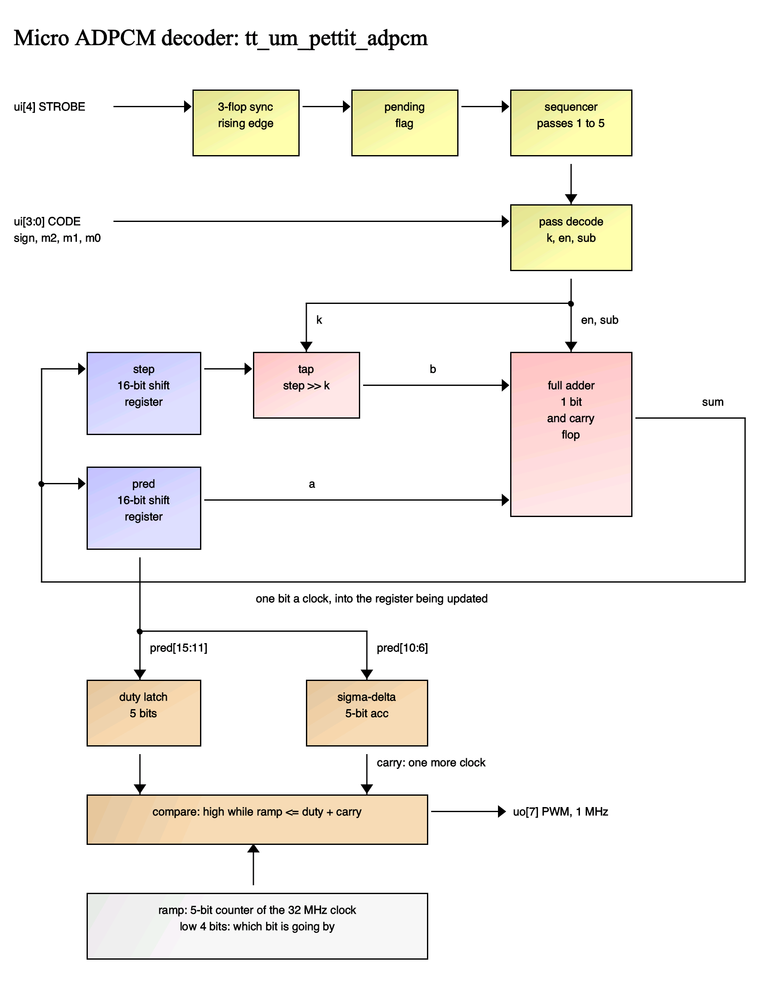

   

# Micro ADPCM: a streaming audio decoder in a Tiny Tapeout micro tile

The host streams 4-bit ADPCM codes, one a sample; the chip decodes them to 16 bits with a
bit-serial datapath (one full adder) and plays them as 1 MHz sigma-delta dithered PWM. 58
flip-flops in the experimental sky130 **micro tile** (70.38 x 51.68 um; `tiles: "micro"`).

<picture>
  <source media="(prefers-color-scheme: dark)" srcset="docs/block_diagram_dark.png">
  <source media="(prefers-color-scheme: light)" srcset="docs/block_diagram.png">
  
</picture>

- [The datasheet](docs/info.md): the codec, the datapath, the host's protocol
- [src/tt_um_pettit_adpcm.v](src/tt_um_pettit_adpcm.v): the design, one file
- [tools/](tools/): `audio2ua.py` converts mp3 / m4a / wma / wav / MIDI to a stream; `uadpcm.py` is the codec (encoder, reference decoder; no dependencies); `mid2wav.py` renders MIDI
- [host/play_ua.py](host/play_ua.py): MicroPython PIO + DMA player for the demo board's RP2
- [host/stream_ua.py](host/stream_ua.py): plays a file of any length by streaming it from a computer over the board's USB port
- [web/](web/): the web player, published at **https://kdp1965.github.io/uadpcm-player/**: drop a music file in the browser, it is converted and streamed to the board over Web Serial, or saved to and played from a QSPI Pmod's flash and PSRAM
- [fpga/](fpga/): the design on the Tiny Tapeout FPGA breakout (iCE40UP5K), where it has been run
- [HARDEN.md](HARDEN.md): the local LibreLane runs

## Make and hear a stream

```sh
python3 -m venv .venv && .venv/bin/pip install -r tools/requirements.txt    # numpy, scipy, mido
.venv/bin/python tools/audio2ua.py song.mp3 song.ua --trim --autoboost      # mp3, m4a, wma, flac, wav, mid ...
python3 tools/uadpcm.py decode song.ua check.wav                            # exactly what the chip will play
```

`audio2ua.py` decodes the file (macOS `afconvert`, or `ffmpeg`), mixes it to mono, trims
silence, raises the level under a look-ahead limiter, fades the ends, resamples to 31250 Hz and
encodes; [tools/README.md](tools/README.md) has every step and option, and the `.ua` file
format (a 12-byte header, then the 4-bit codes two to a byte).

## Simulation

```sh
cd test
make                              # RTL: 3000 samples streamed in, every clock against test/model.py
make GATES=yes                    # the same on gate_level_netlist.v (needs PDK_ROOT)
PERIOD=1024 SAMPLES=400 make      # at the real 31250 Hz strobe rate
```

## On the FPGA breakout

The design runs on the Tiny Tapeout FPGA breakout (RP2350 + iCE40UP5K) today, with the web
player at **https://kdp1965.github.io/uadpcm-player/** (Chrome or Edge):

1. Audio Pmod on the output (`uo`) port; optionally a Tiny Tapeout QSPI Pmod on the
   bidirectional (`uio`) port.
2. Connect the breakout by USB, open the page, press *Connect* and choose the board's port. The
   page uploads this design's bitstream if the board does not have it (it asks before
   replacing a running design).
3. Click a ready-made song or drop a music file, and press *Play on chip*. With the QSPI Pmod,
   *Save to board* stores songs in its flash or PSRAM for the board to play on its own.

The bitstream comes from the `fpga` GitHub action (the `fpga_bitstream` artifact) or from a
local build, and the command-line players still work:

```sh
cd fpga && make && make upload PORT=/dev/cu.usbmodemXXXX     # OSS CAD Suite and mpremote on the PATH
make web                                                     # ../web/bitstream.js, the copy the page uploads
python3 host/stream_ua.py song.ua /dev/cu.usbmodemXXXX       # stream a file from the computer
```

Checked on 2026-11-25 with a logic analyser on `uo_out`: 116,518 consecutive samples of a
streamed song, the duty after every code equal to the reference decoder's, a code every 32.00 us
with no gap between blocks; the same for about 87,000 samples played from the Pmod's flash and
from its PSRAM, and across a pause.

## Hardening locally

```sh
cd harden
make harden TAG=rc2        # runs/rc2/final/{gds,lef,pnl,...}; python3 metrics.py runs/rc2
make synth TAG=s1          # synthesis only (seconds): the area
```
