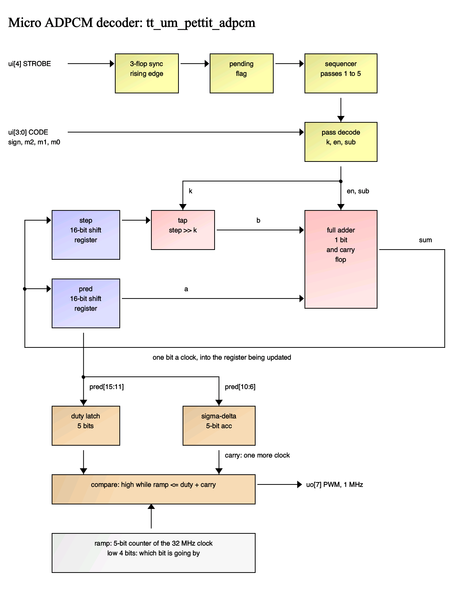

## How it works

Micro ADPCM is a streaming audio decoder in a Tiny Tapeout **micro tile**: 70.38 x 51.68 um of
sky130, a quarter of a 1x1 tile, with only `clk`, `rst_n`, `ui_in` and `uo_out`. A host (the demo
board's microcontroller) sends one 4-bit code per audio sample; the chip turns each code into a
16-bit sample and plays it as 1 MHz pulse-width modulation, which a low-pass filter makes into
audio. A 3.6 minute song at 31250 samples a second is 3.4 MB of codes. The whole design is 58
flip-flops and about 150 gates.

### The codec: uADPCM

Adaptive differential PCM sends, instead of each sample, how far it is from the previous one,
measured in units of a step size that adapts: after a large code the step grows, so that loud or
fast passages can be followed, and after a small code it shrinks, so that quiet ones are fine
grained. The decoder keeps two numbers, the *predictor* (the current sample, 16 bits unsigned,
0x8000 after reset) and the *step* (16 bits, 16 after reset). The encoder runs the same
arithmetic, so the two stay together with nothing but the codes passing between them.

A code is 4 bits, `{sign, m2, m1, m0}`. Each one does two things:

    delta = step/8 + (m2 ? step : 0) + (m1 ? step/2 : 0) + (m0 ? step/4 : 0)
    pred  = sign ? pred - delta : pred + delta

    step  = m2 ? step + (step >> (3 - {m1,m0}))    times 1.125, 1.25, 1.5 or 2
               : step - step/16                    times 0.94; stops at 15 by itself

The magnitude `m` moves the predictor by (2m + 1)/8 of a step, so the eight magnitudes cover
1/8 to 15/8 of a step. Magnitudes 0 to 3 mean the step was large enough and let it decay;
magnitudes 4 to 7 mean it was too small and grow it, the more the larger the code. Every term
is the step shifted right by 0 to 4 places: the decoder needs no table and no multiplier.

It has no limiters either. The encoder simulates the decoder and, for every sample, picks the
code whose result is nearest the input *among those that keep the predictor and the step inside
16 bits*, so a valid stream cannot overflow. At 4 bits a sample the quality is that of the
common table-driven ADPCM codecs: 37.6 dB signal-to-noise on a pop song at 31250 Hz, against
37.5 dB for IMA ADPCM on the same audio.

### The datapath: one full adder

Everything is bit-serial. The predictor and the step are two 16-bit shift registers that rotate
all the time, least significant bit first, one turn every 16 clocks; a 5-bit counter `ramp`
counts the clocks, and its low 4 bits say which bit is going by. A register that is not being
updated shifts its bit 0 back in at the top. One that is being updated shifts in the output of
the single full adder instead, so after a turn it holds the sum. A shift register built this
way needs no enables and no multiplexers in front of its flops, which is what makes it fit.

The adder's second operand is a *tap* of the step register. While bit `i` of the step is at the
bottom of the register, bit `i + k` is `k` places up, so reading the register at position `k`
gives the step shifted right by `k`, with no shifter at all (the tap is forced to 0 once
`i + k` passes 15, where the register has wrapped round). Subtracting is adding the inverted
tap with the carry set on the first bit.

One sample is five turns ("passes"), 80 clocks:

| pass | updates | adds | when |
|------|---------|------|------|
| 1 | predictor | step >> 3 | always |
| 2 | predictor | step | `m2` |
| 3 | predictor | step >> 1 | `m1` |
| 4 | predictor | step >> 2 | `m0` |
| 5 | step | step >> (3 - `{m1,m0}`), or minus step >> 4 | `m2`, or not |

Passes 1 to 4 subtract when the sign bit is set. In pass 5 the step is read at the tap while
its new value is shifted in at the top, which is safe because the new bits do not reach the tap
before the turn ends.

The strobe from the host goes through a three-flop synchronizer; its rising edge sets a
"pending" flag, and the next turn that starts with the flag set is pass 1. The code itself is
not stored: the datapath reads `ui[3:0]` during the five passes, which is why the host must
hold it (see below). The first turn after reset is an initialisation pass that shifts the
constants 0x8000 and 16 into the two registers.

### The output: 1 MHz PWM with sigma-delta

With a 32 MHz clock, two turns of the registers are 32 clocks, one period of 1 MHz. At the
start of each period the registers are back in their home position, and the top 5 bits of the
predictor are taken as the duty: the output is high for that many of the 32 clocks. The next 5
bits are added into a 5-bit accumulator each period, and when it overflows the pulse is one
clock longer. Over 32 periods (one sample at 31250 Hz) the high time averages to the top 10
bits of the sample, and the error that is left is pushed up to frequencies the output filter
removes. 1 MHz was chosen for the Tiny Tapeout audio Pmod, whose filter rolls off gently from
about 200 kHz.

While a code is being decoded the predictor passes through up to three intermediate values
(one per term added), each on the way from the old sample to the new one; a PWM period that
starts in those 2 microseconds plays one of them.

## How to test

Connect the [Tiny Tapeout audio Pmod](https://github.com/MichaelBell/tt-audio-pmod) so that its
input is `uo[7]`, set the clock to 32 MHz and hold reset for 16 clocks or more. The output then
idles at 50% duty (silence).

| Pin | Function |
|-----|----------|
| `ui[3:0]` | CODE: `ui[3]` sign (1 = down), `ui[2:0]` magnitude |
| `ui[4]`   | STROBE: a rising edge takes the code |
| `uo[7]`   | PWM audio, 1 MHz |
| `uo[6]`   | the predictor going by, bit 0 first, 16 clocks a turn (bit 0 is on the pin two clocks before the PWM rises) |
| `uo[5]`   | BUSY: a code is waiting or being decoded |
| `uo[4:0]` | the PWM duty: the top 5 bits of the sample |

### The host's protocol

For every sample the host puts the code on `ui[3:0]`, then raises `ui[4]` (STROBE), and leaves
the code there for at least 3.5 microseconds (112 clocks) after the rising edge; the strobe
must be low again for 100 ns or more before the next one. The strobe is synchronized in the
chip, so the host needs no relation to the chip's clock, and the sample rate is simply the
host's strobe rate: 31250 Hz by default, anything up to about 250 kHz.

There is no framing and no resynchronisation: a lost or repeated code shifts everything after
it. Reset the chip before each stream (streams are encoded from the reset state). Sending code
0 repeatedly lets the step fall back to its minimum.

On the demo board the RP2 microcontroller does this with a two-instruction PIO program at 16
PIO clocks per sample, fed by DMA, so that the processor only refills buffers:

    out(pins, 4).side(0)[7]      ; the next code; strobe low for half a sample
    nop().side(1)[7]             ; strobe high; the code stays until the next one

`host/play_ua.py` is that player in MicroPython, with two DMA channels chained to each other so
that there is no gap between blocks; `host/stream_ua.py` runs on a computer and streams a file
of any length through the board's USB port.

### Making a stream

`tools/audio2ua.py song.mp3` converts a music file (mp3, m4a, wma, flac, wav, ... or a MIDI
file) into a `.ua` stream: it decodes the file, mixes it to mono, optionally trims silence and
raises the level under a look-ahead peak limiter, fades the ends, resamples to 31250 Hz and
encodes. `--wav check.wav` also writes exactly what the chip will play. A `.ua` file is the
four characters `uADP`, the number of samples and the sample rate (two little-endian 32-bit
numbers), then the codes, two to a byte, the first in the low nibble.

The design and the player have been run on the Tiny Tapeout FPGA breakout (`fpga/`): with a
logic analyser on `uo_out`, the duty after each of 70,124 consecutive codes of a song was the
reference decoder's.

## External hardware

[Tiny Tapeout audio Pmod](https://github.com/MichaelBell/tt-audio-pmod) (or any low-pass filter
and amplifier) on `uo[7]`.
